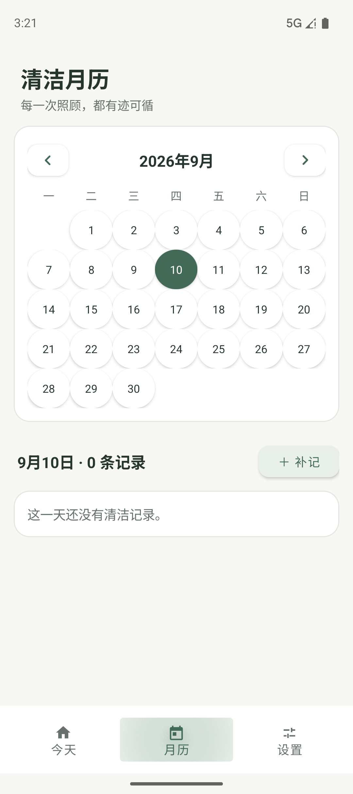
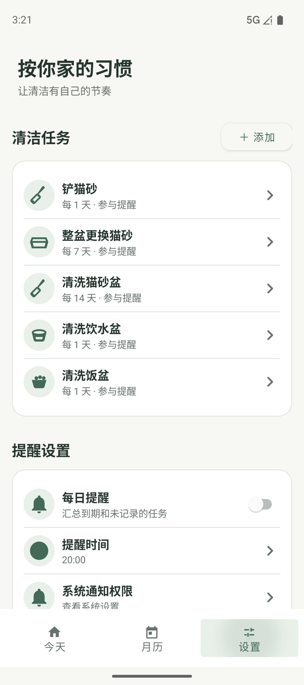
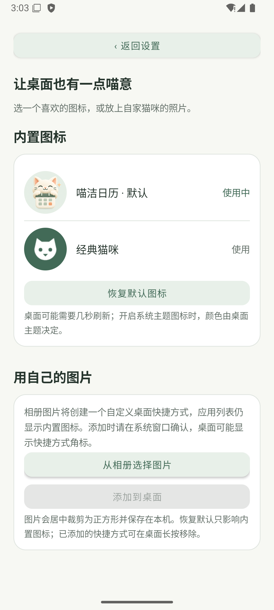
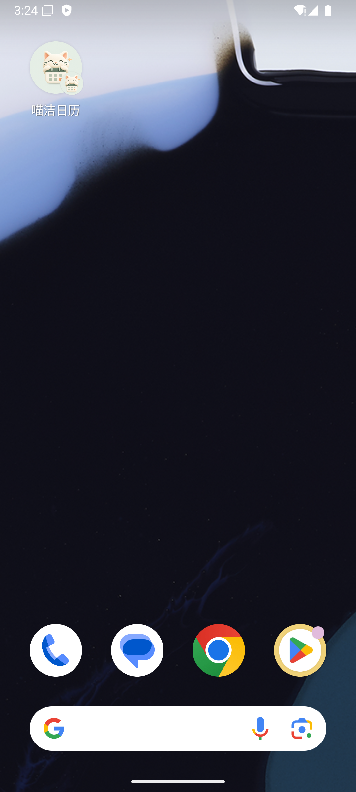

# 喵洁日历 / Meow Care

Java 原生 Android 应用。记录猫砂盆、饮水盆和饭盆等物品的清洁历史，按实际完成日期计算下次到期。

## 预览

喵洁日历用清爽的奶油白与鼠尾草绿记录猫咪日常清洁，也支持自适应桌面图标和自定义图片图标：

| 月历 | 设置 | 自定义图标 |
| --- | --- | --- |
|  |  |  |

桌面图标会交给系统的圆形、方形或圆角方形遮罩处理，不额外绘制白色边框：



## 开发

在 Android Studio 中打开本目录。应用源码使用 Java 17，界面使用 XML，最低 Android 8.0（API 26）。构建使用 Android SDK 35、AGP 8.7.3 和 Gradle 8.9。JDK 推荐 Android Studio 随附的 JBR 21。

`local.properties` 是本机配置，不应加入版本控制。换电脑后通过 Android Studio 指定自己的 SDK 路径。

Windows 构建（脚本只临时设置当前进程环境，不修改系统设置）：

```powershell
.\scripts\build.ps1
```

单独执行任务：

```powershell
.\scripts\build.ps1 -Tasks testDebugUnitTest
.\scripts\build.ps1 -Tasks connectedDebugAndroidTest
```

也可以使用标准 `gradlew.bat`。若出现 Java `Unable to establish loopback connection`，使用上述脚本中的项目内临时目录配置。

Debug APK 输出：`app/build/outputs/apk/debug/app-debug.apk`。

当前界面采用奶油白与鼠尾草绿主题，包含紧凑任务卡、平面月历、记录时间线和分组设置页，同时提供深色模式配色。实际截图与检查记录见 `docs/verification.md`。

## 自定义图标

进入 **设置 → 外观设置 → App 图标**：

- 内置「喵洁日历」猫咪日历图标与「经典猫咪」图标，可切换应用的桌面入口，并恢复默认。系统可能在切换后返回桌面，重新打开即可；桌面可能延迟刷新。Android 13 及以上的系统主题图标使用单色猫咪轮廓。
- 从相册选择自己的图片，居中取景并按系统图标形状预览，然后点击「添加到桌面」，在系统窗口确认。使用 adaptive bitmap 铺满圆形、方形或圆角方形遮罩，不额外添加白色外框。此方式创建自定义快捷方式，应用列表仍使用内置图标；右下角角标由桌面添加，应用不能保证隐藏。不需要快捷方式角标时使用上方应用图标。
- 选图不需要整个相册的读取权限。图片缩小后保存在应用私有目录；取消选图或读取失败会保留已保存的图片。重复添加使用同一快捷方式 ID 更新图片；部分桌面仍可能创建多个图标。
- 切换内置图标时会迁移本应用的自定义快捷方式归属。恢复默认不会删除桌面快捷方式，可在桌面长按移除。
- 升级修复版后首次打开 App，会自动将已有的旧版位图快捷方式更新为自适应图标，无需重新创建。更新失败时可进入图标设置，点击「添加到桌面」重试。

图标原图与生图提示词见 [assets/app-icon/README.md](assets/app-icon/README.md)。使用内置生图工具生成，未指定模型版本。

手机通过 USB 连接并允许调试后，可直接安装已有 APK（不需要模拟器）：

```powershell
$adb = 'D:\Program Files\AndroidSDK\platform-tools\adb.exe'
& $adb devices -l
# 将 SERIAL 替换为上一步列出的设备序列号；-r 保留现有应用数据。
& $adb -s SERIAL install --user 0 -r .\app\build\outputs\apk\debug\app-debug.apk
& $adb -s SERIAL shell am start --user 0 -n com.meowcare.app/.MainActivity
```

设备保持解锁且本应用位于前台时，可捕获截图及界面层级：

```powershell
.\scripts\capture-device.ps1 -Serial SERIAL -Name today
```

截图存放于 `captures/`，脚本不读取其他应用日志或数据。执行前请将测试设备切到本应用。

## 产品规则

- 首次安装只提供任务，不提供虚假完成记录。
- 最后完成时间来自真实历史的最大时间；补记旧记录不会覆盖更新记录。
- 周期按本地自然日计算，不是滚动的 24 小时倒计时。
- 本地数据保存在应用私有 SQLite 数据库。卸载或清除应用数据会删除记录；第一版尚无导出、云备份和家庭同步。
- 通知默认关闭。每日提醒为非精确通知，系统和手机厂商的省电策略可能延迟。强行停止应用后需重新打开才能恢复调度。
- 不预设医学标准；任务周期请按自家物品使用情况设置。

## 文档

- [需求与架构](docs/superpowers/specs/2026-09-06-meow-care.md)
- [实施计划](docs/superpowers/plans/2026-09-06-meow-care.md)
- [验证结果与待测项](docs/verification.md)

本工程为 v0.1 开发版本。未执行商店上架或生产签名。
